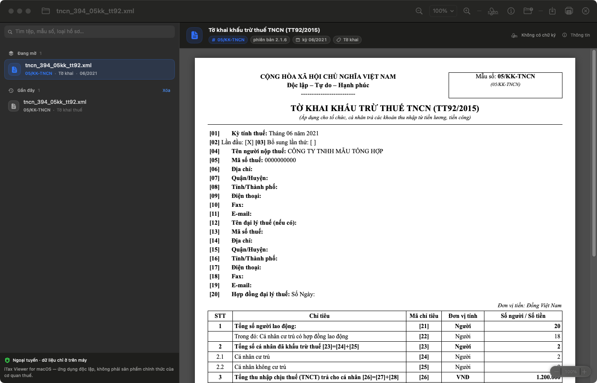
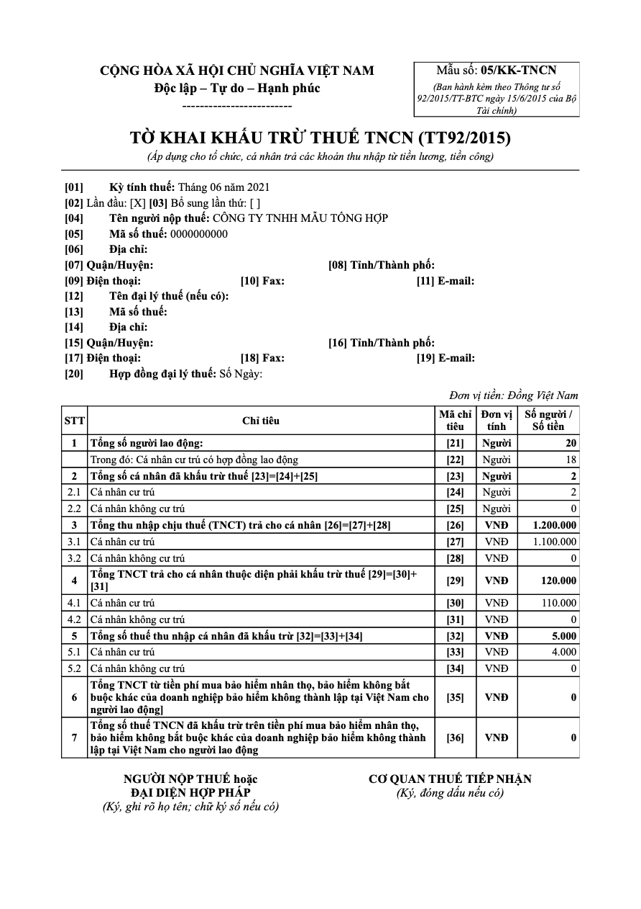

# iTax Viewer cho macOS

<p align="center">
  
</p>

<p align="center">
  Ứng dụng macOS độc lập để đọc hồ sơ thuế XML, in và xuất PDF ngay trên máy.<br>
  Hỗ trợ cả Apple Silicon và Intel, không tải hồ sơ lên mạng.
</p>

<p align="center">
  <a href="https://github.com/dieutx/itaxviewer-macos/actions/workflows/macos.yml"></a>
  <a href="https://github.com/dieutx/itaxviewer-macos/releases/latest"></a>
  <a href="LICENSE"></a>
</p>

> [!IMPORTANT]
> Đây là dự án cộng đồng độc lập, **không phải phần mềm chính thức của cơ quan thuế**.
> Ứng dụng không thay thế tư vấn thuế, pháp lý hoặc việc kiểm tra hồ sơ trên hệ thống chính thức.



*Ảnh chụp từ ứng dụng thật với hồ sơ tổng hợp dành riêng cho kiểm thử; không chứa dữ liệu người nộp thuế.*

## Mục lục

- [Tải và cài đặt](#tải-và-cài-đặt)
- [Dùng nhanh](#dùng-nhanh)
- [Ứng dụng hỗ trợ gì?](#ứng-dụng-hỗ-trợ-gì)
- [Quyền riêng tư và an toàn](#quyền-riêng-tư-và-an-toàn)
- [Kiểm thử và tự build](#kiểm-thử-và-tự-build)
- [Góp ý và đóng góp](#góp-ý-và-đóng-góp)

## Tải và cài đặt

1. Mở trang [Bản phát hành mới nhất](https://github.com/dieutx/itaxviewer-macos/releases/latest).
2. Tải `iTaxViewerMac-unsigned.dmg`. Đây là bản universal dùng được trên cả Mac Apple Silicon và Intel.
3. Mở DMG và kéo **iTax Viewer for macOS** vào **Applications**.
4. Mở ứng dụng, nhấn `⌘O` và chọn hồ sơ XML cần xem.

Yêu cầu **macOS 13 Ventura trở lên**. Có thể đối chiếu file tải về với `SHA256SUMS.txt` trong release.

Bản hiện tại được ký ad-hoc, chưa có Developer ID và chưa được Apple notarize. Nếu Gatekeeper chặn lần mở đầu tiên, hãy nhấp phải ứng dụng, chọn **Open**, rồi xác nhận **Open**. Không cần và không nên tắt Gatekeeper cho toàn hệ thống.

## Dùng nhanh

| Thao tác | Phím tắt |
|---|---|
| Mở XML | `⌘O` |
| In | `⌘P` |
| Xuất PDF | `⌘S` |
| Phóng to / thu nhỏ / kích thước thật | `⌘+` / `⌘−` / `⌘0` |
| Xem thông tin hồ sơ | `⌘I` |
| Xem thông tin chữ ký | `⇧⌘Y` |

Bạn cũng có thể kéo tệp XML vào cửa sổ ứng dụng hoặc chọn **Open With → iTax Viewer for macOS** trong Finder.

## Ứng dụng hỗ trợ gì?

- Hiển thị các tờ khai GTGT, TNCN, TNDN và một số báo cáo tài chính, thông báo, giấy nộp tiền, phụ lục đã được rà soát.
- Nhận diện 410 mã biểu mẫu. Phiên bản chưa có bố cục riêng vẫn được mở dưới dạng bảng dữ liệu có cảnh báo rõ ràng.
- In và xuất PDF nhiều trang khổ A4, giữ đúng bố cục biểu mẫu.
- Đọc XML hoàn toàn ngoại tuyến; không có telemetry, analytics, upload hoặc xử lý đám mây.

<p align="center">
  
</p>

*PDF xuất trực tiếp từ ứng dụng, khổ A4, dùng cùng hồ sơ tổng hợp.*

Danh sách mẫu/phiên bản và mức độ tương thích thực tế nằm trong [COMPATIBILITY.md](COMPATIBILITY.md).

### Giới hạn hiện tại

- Một số bảng nhiều trang có thể ngắt hàng hoặc chưa lặp tiêu đề cột giống bản Windows.
- Bố cục của mọi mã/phiên bản chưa thể giống hoàn toàn ứng dụng gốc.
- Chữ ký số chỉ được đọc metadata và luôn hiển thị **“Chưa xác minh”**; ứng dụng chưa xác minh XMLDSig.
- Finder double-click, kéo thả, print panel và máy in vật lý vẫn cần thêm kiểm thử thủ công trên nhiều máy.

## Quyền riêng tư và an toàn

Hồ sơ thuế chỉ được xử lý trong máy. WebView tắt JavaScript, chặn điều hướng và nội dung từ xa, dùng kho dữ liệu không lưu; parser từ chối `DOCTYPE`/`ENTITY`, external entity và tài liệu vượt giới hạn an toàn.

Không gửi hồ sơ thật, mã số thuế, tên, địa chỉ, chữ ký số hoặc ảnh chụp chứa dữ liệu người nộp thuế vào Issue/Discussion. Xem [chính sách bảo mật](SECURITY.md) và [thiết kế an toàn](docs/security.md).

## Kiểm thử và tự build

CI đã chạy cùng một binary universal trên macOS Apple Silicon và Intel: mỗi kiến trúc chạy **99 test (98 đạt, 1 test tùy chọn bỏ qua)**, mở 29 fixture an toàn và xuất 29 PDF/55 trang A4. Các giới hạn thủ công hoặc trực quan vẫn được ghi là pending, không coi là đã xác minh.

Mỗi tag `v*` được workflow **Release** kiểm thử lại, build universal, tạo DMG/ZIP, ghi `SHA256SUMS.txt` và đăng GitHub Release. Không có bước tự động cập nhật nào chạy trên máy người dùng.

Cần Xcode 15+, Swift 5.9+ và Python 3.10+:

```bash
git clone https://github.com/dieutx/itaxviewer-macos.git
cd itaxviewer-macos/iTaxViewerMac
swift test
python3 scripts/validate_fixtures.py
scripts/build_app.sh --universal --dmg
open build/iTaxViewerMac.app
```

Từ Windows, có thể yêu cầu build qua GitHub Actions:

```powershell
powershell -File iTaxViewerMac/scripts/Build-MacOS.ps1 -Ref main
```

## Góp ý và đóng góp

- Gặp lỗi: [tạo báo lỗi](https://github.com/dieutx/itaxviewer-macos/issues/new?template=bug_report.yml).
- Cần hỗ trợ thêm biểu mẫu: [gửi yêu cầu biểu mẫu](https://github.com/dieutx/itaxviewer-macos/issues/new?template=form_support.yml) bằng cấu trúc tổng hợp/đã ẩn danh, không gửi hồ sơ thật.
- Có ý tưởng: [đề xuất tính năng](https://github.com/dieutx/itaxviewer-macos/issues/new?template=feature_request.yml).
- Muốn gửi code: đọc [CONTRIBUTING.md](CONTRIBUTING.md) và mở Pull Request.
- Câu hỏi sử dụng: vào [Discussions](https://github.com/dieutx/itaxviewer-macos/discussions).

Tài liệu dành cho người phát triển: [macOS handoff](docs/MACOS_HANDOFF.md) · [phân tích tương thích](docs/reverse-engineering/) · [quy tắc ứng xử](CODE_OF_CONDUCT.md).

## Giấy phép và nguồn gốc

Mã nguồn và tài liệu nguyên bản của dự án được phát hành theo [MIT License](LICENSE). Dự án không đóng gói XSLT, CSS, phông chữ, hình ảnh hay biểu tượng từ bộ cài iTax Viewer gốc. Tên biểu mẫu, nhãn và mã trường là dữ kiện phục vụ khả năng tương tác với tài liệu thuế công khai.
