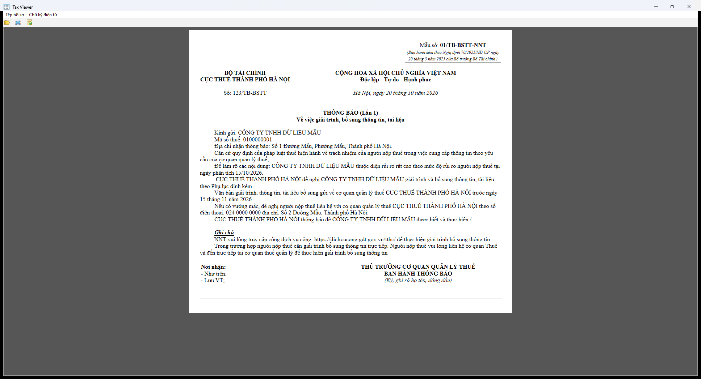

# 01/TB-BSTT — Thông báo giải trình, bổ sung thông tin

- Kind: `notice`
- Root: **`TBao`** (không phải `TBaoThueDTu`)
- Detect: root `TBao` + `MSo=01/TB-BSTT` (regex `isTBaoHDDT`) + `PBan=2.1.0`
- Handler: `taxMessage.TBaoHDDT`
- Registry: `data/DMucTBao.xml` với `maTBao="01/TB-BSTT"`, `pbanTBao="2.1.0"`
- Template: `data/xslt/XSLT 2.8.1/TBaoThue/xslt/TBao_107_TB_BSTT.xslt`
- Spec: [`01-TB-BSTT.json`](01-TB-BSTT.json)



## Sửa hiểu nhầm của bản clone

`iTaxViewerMac/Tests/…/Fixtures/tbao_107_bstt.xml` dùng root `TBaoThueDTu` + `maTBao=107` + `pbanTBao=3.0.7`.
Bản gốc **từ chối** file đó:

```
seatechit.ihtkk.tool.ITaxViewerException:
Mã Thông báo (107) hoặc phiên bản thông báo (3.0.7) không đúng
```

Sau khi sửa thành `root=TBao`, `MSo=01/TB-BSTT`, `PBan=2.1.0` thì app render đúng (ảnh trên). Đây là
cùng khuôn `TBao` dùng cho thông báo hóa đơn điện tử (`TBaoHDDT`), không phải `TBaoThueDTu`.

## Đầu văn bản

| Thành phần | Giá trị / nguồn |
|---|---|
| Mẫu số | `01/TB-BSTT-NNT` — **hard-code** trong `tbaoheader.xsl` |
| Cơ quan dòng 1 | `TBao/DLTBao/TCQTCTren` |
| Cơ quan dòng 2 | `TBao/DLTBao/TCQT` |
| Số | `TBao/STBao/So` (không dùng tham số `soTBao`) |
| Ngày | `TBao/STBao/NTBao` |
| Tiêu đề | `THÔNG BÁO (Lần {DLTBao/LGTrinh})` + `Về việc giải trình, bổ sung thông tin, tài liệu` |
| Mô tả mẫu | "Ban hành kèm theo Nghị định 70/2025/NĐ-CP ngày 20 tháng 3 năm 2025…" |

## Thân văn bản

`Kính gửi`, `Mã số thuế`, `Địa chỉ nhận thông báo`; căn cứ pháp lý; nội dung rủi ro cao tại ngày
`NPTich`; đề nghị giải trình + phụ lục; hạn bổ sung `THGTBSung`; liên hệ `DTCQT`/`DCCQT`; ghi chú
cổng dịch vụ công; khối "Nơi nhận" + "THỦ TRƯỞNG CƠ QUAN QUẢN LÝ THUẾ" + `sigDiv`.

## Đã chạy / bằng chứng

| Quan sát | Bằng chứng |
|---|---|
| Render đúng, 1 trang A4 dọc | `original-01-TB-BSTT-p1.png` |
| PDF do app xuất: **1 trang**, 595×842 pt | `original-01-TB-BSTT-export.pdf` |
| Fixture cũ `tbao_107_bstt.xml` bị từ chối | stderr 2026-10-22 |
| Ảnh in `01/TB-BSTT-NNT` dù mã là `01/TB-BSTT` | ảnh trên |

## Chưa xác minh

- Phụ lục `TBao_107_TB_BSTT_PL.xslt` chưa capture.
- Các mã `01/TB-BSTT-NNT`, `01/TB-SSĐT`, `01/TB-ĐKĐT`, `01/TB-TNĐT`, `01/TB-NSD`, `01/CCTT-TB` chưa capture.
