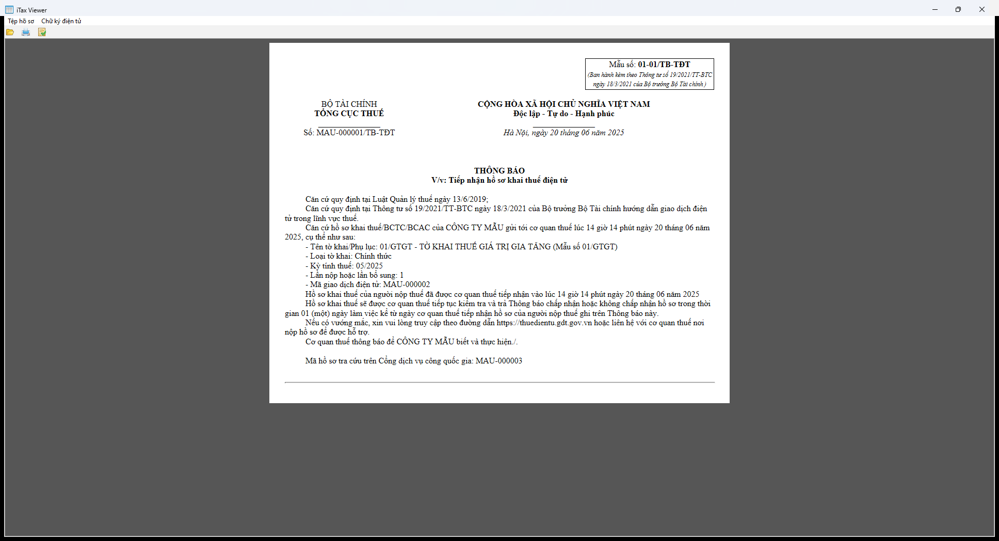

# 843 — Thông báo tiếp nhận hồ sơ khai thuế điện tử (01-01/TB-TĐT)

- Kind: `notice`
- Root: `TBaoThueDTu` (bắt buộc **không** có prefix)
- Detect: `maTBao=843` + `pbanTBao` (bản này 2.5.6)
- Handler: `taxMessage.TBaoThue`
- Template: `data/xslt/XSLT 2.5.6/TBaoThue/xslt/TBao_01_1_TT19_KeKhai.xslt`
- Spec: [`843.json`](843.json)

## Đầu văn bản

| Thành phần | Giá trị / nguồn |
|---|---|
| Mẫu số | `01-01/TB-TĐT` (literal) |
| Cơ quan | `BỘ TÀI CHÍNH` / `TỔNG CỤC THUẾ` (literal) |
| Số | `TBaoThue/TTinChung/TTinTBaoThue/soTBao` + `/TB-TĐT` |
| Ngày | `ngayTBao` → `Hà Nội, ngày dd tháng mm năm yyyy` |
| Tiêu đề | `THÔNG BÁO` + `V/v: Tiếp nhận hồ sơ khai thuế điện tử` (literal) |

## Thân văn bản

Hai nhánh theo `NDungTBao/trangThai`:

- `Y` hoặc `0`: đã tiếp nhận. In tên tờ khai, loại tờ khai, kỳ tính thuế, lần nộp, mã giao dịch, thời điểm tiếp nhận (`ngayHoSo`), câu "sẽ được kiểm tra và trả Thông báo … trong thời gian 01 (một) ngày làm việc".
- `N`: không tiếp nhận. In cùng 4 dòng hồ sơ + bảng lý do 4 cột (`STT`, `Mô tả lỗi`, `Hướng dẫn xử lý`, `Ghi chú`) từ `LyDo/CTietLyDo` + câu đề nghị điều chỉnh.

Kết thúc: câu hỗ trợ, "Cơ quan thuế thông báo để {tenNNhan} biết và thực hiện./.", mã hồ sơ tra cứu `maDVC`.

## Đã chạy / bằng chứng

| Quan sát | Bằng chứng |
|---|---|
| Bản gốc render đúng 1 trang A4 dọc | `original-843-p1.png` |
| PDF do app xuất: **1 trang**, 595×842 pt, không rotate | `original-843-export.pdf` |
| File có prefix `ns0:` bị từ chối ("Tệp hồ sơ không đúng định dạng") | stderr của `TaxViewer` (2026-10-22) |
| Sau khi bỏ prefix và dùng default namespace → mở được | `original-843-p1.png` |
| Template in đúng số tiền/nội dung từ XML giả | ảnh trên |

## Chưa xác minh

- Nhánh `trangThai=N` chưa có ảnh/PDF (chưa có file mẫu bị từ chối).
- Các version khác của 843 (2.4.9, 3.0.0, 3.0.1, 2.5.8, 2.5.9) chưa capture.
