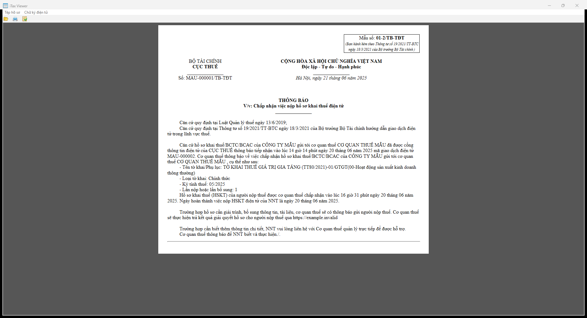

# 844 — Thông báo chấp nhận hồ sơ khai thuế điện tử (01-2/TB-TĐT)

- Kind: `notice`
- Root: `TBaoThueDTu` (không prefix)
- Detect: `maTBao=844` + `pbanTBao=2.4.9`
- Handler: `taxMessage.TBaoThue`
- Template: `data/xslt/XSLT 2.4.9/TBaoThue/xslt/TBao_01_2_TT19_KeKhai.xslt`
- Spec: [`844.json`](844.json)

## Đầu văn bản

| Thành phần | Giá trị / nguồn |
|---|---|
| Mẫu số | `01-2/TB-TĐT` (literal) |
| Cơ quan | `BỘ TÀI CHÍNH` / `TỔNG CỤC THUẾ` (literal) |
| Số | `soTBao` + `/TB-TĐT` |
| Ngày | `ngayTBao` → `Hà Nội, ngày dd tháng mm năm yyyy` |
| Trích yếu | `trangThai=Y` → "Chấp nhận…", `trangThai=N` → "Không chấp nhận…" |

## Thân văn bản

- Nhánh `Y`: nêu cơ quan thuế `CQT/tenCQT`, thời điểm tiếp nhận `ngayNopThucTe`, mã giao dịch `maGiaoDichDTu`; 4 dòng hồ sơ; thời điểm chấp nhận `ngayHoanThanh`; ngày hoàn thành `ngayChapNhan`; câu trả kết quả qua `duongDan`.
- Bảng "Thông tin mã định danh khoản phải nộp" (chỉ in khi `IDKhoanNop/CTietIDKhoanNop/maDinhDanh` khác rỗng): `STT`, `Mã định danh`, `Số tiền thuế phải nộp` (định dạng `1.000.000`), `Loại tiền`, `Ghi chú`. Ghi chú tự sinh khi `loaiToKhai=Bổ sung` và tiền âm/dương.
- Nhánh `N`: bảng lý do 4 cột (`Thông tin có sai sót` = `tenNhomLoi (tenLoi)`), câu đề nghị điều chỉnh.

## Đã chạy / bằng chứng

| Quan sát | Bằng chứng |
|---|---|
| Render đúng 1 trang A4 dọc | `original-844-p1.png` |
| PDF do app xuất: **1 trang**, 595×842 pt | `original-844-export.pdf` |
| Bảng khoản nộp hiện `1.000.000` từ `soTienPNop` | ảnh trên |
| Prefix `ns0:` bị từ chối, default namespace mở được | stderr + ảnh |

## Chưa xác minh

- Nhánh `N` và trường hợp tiền âm chưa capture.
- Chỉ có một version 2.4.9 trong registry.
