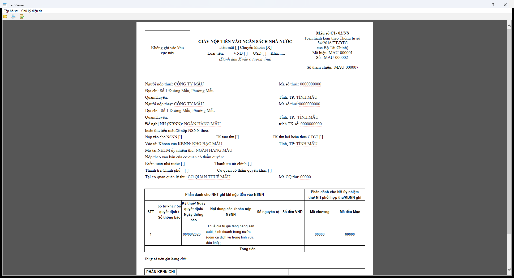
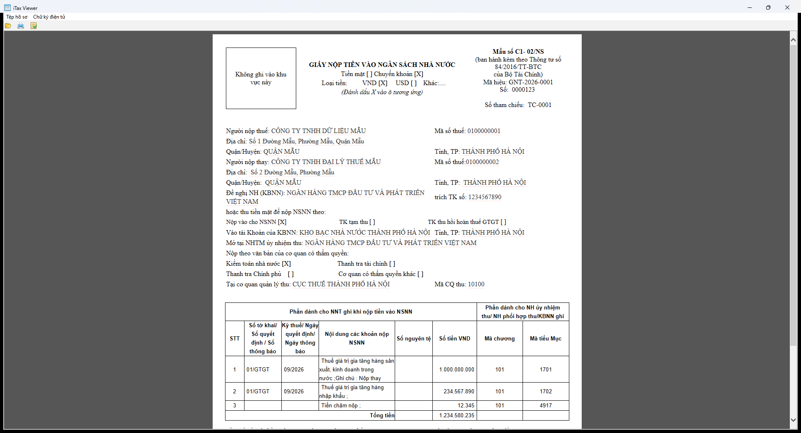
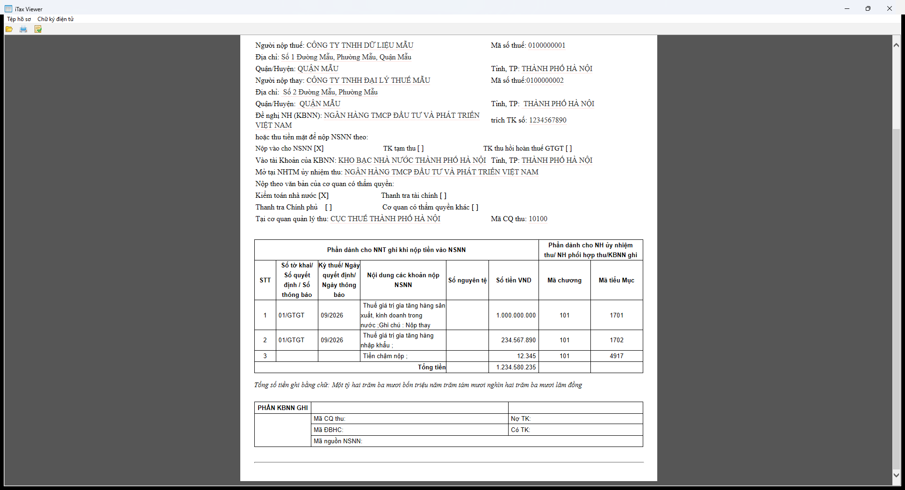

# CT-01 — Giấy nộp tiền vào NSNN (mẫu C1-02/NS)

- Kind: `paymentVoucher`
- Root: `CHUNGTU`
- Detect: `MA_CTU=01` + `PBAN_TLIEU_XML` (`data/DMucCTu.xml`, versions 1.0.0 / 3.0.0 / 4.0.0 / 4.0.1 / 4.0.2)
- Handler: `taxvoucher.GNTNSNN`
- Captured version: 4.0.1 (`data/xslt/CTu/GNT_4_0_1.xsl`)
- Spec: [`CT-01.json`](CT-01.json)

Ảnh gốc (dữ liệu giả):

Ảnh có `MA_NGUYENTE=VND`, 3 dòng chi tiết (bản synthetic):

## Bố cục

| Khối | Nội dung | Nguồn |
|---|---|---|
| Đầu chứng từ | "GIẤY NỘP TIỀN VÀO NGÂN SÁCH NHÀ NƯỚC", Mẫu số C1-02/NS (TT 84/2016/TT-BTC), Mã hiệu, Số, Số tham chiếu | `MAHIEU_CTU`, `SO_CTU`, `MA_THAMCHIEU` |
| Ô chọn | Tiền mặt [ ] / Chuyển khoản [X] (hard-code), Loại tiền VND/USD theo `MA_NGUYENTE` | `MA_NGUYENTE` |
| Người nộp | tên, MST, địa chỉ, quận/huyện, tỉnh; người nộp thay tương tự | `TEN_NNOP`, `MST_NNOP`, `DIACHI_NNOP`, `TEN_HUYEN_NNOP`, `TEN_TINH_NNOP`, `TEN_NTHAY`, `MST_NTHAY`, `DIACHI_NTHAY`, `TEN_HUYEN_NTHAY`, `TEN_TINH_NTHAY` |
| KBNN / ngân hàng | Đề nghị NH (KBNN), trích TK số, vào tài khoản KBNN, tỉnh KBNN, NHTM ủy nhiệm thu | `TEN_NHANG_NOP`, `STK_NHANG_NOP`, `TEN_KBAC`, `TEN_TINH_KBAC`, `TEN_NHANG_UNT` |
| Ô chọn khoản | Nộp vào NSNN (`STK_THU=7111`), TK tạm thu (luôn trống), TK thu hồi hoàn thuế GTGT (`8991/3121/8993/3397`) | `STK_THU` |
| Căn cứ nộp | Kiểm toán nhà nước `01`, Thanh tra tài chính `02`, Thanh tra Chính phủ `03`, Cơ quan khác `04` | `ID_TK_KNGHI` |
| Cơ quan thu | Tên + mã | `TEN_CQTHU`, `MA_CQTHU` |
| Bảng chi tiết | 8 cột, gộp nhóm "Phần dành cho NNT ghi…" (6 cột) và "Phần dành cho NH ủy nhiệm thu/…" (2 cột) | `CHUNGTU_CTIET/ROW_CTIET` |
| Tổng | "Tổng tiền" + `TONG_TIEN` định dạng `1.234.580.235` | `TONG_TIEN` |
| Tiền bằng chữ | "Một tỷ hai trăm ba mươi bốn triệu … đồng" | `TONG_TIEN` qua `DocTienBangChu` |
| KBNN ghi | Mã CQ thu, Nợ TK, Mã ĐBHC, Có TK, Mã nguồn NSNN (CT 01) / thêm Tỷ giá hạch toán (CT 02) | trống |
| Chữ ký | `div id=sigDiv` trống + đường kẻ | — |

## Quan sát đã chạy

| Quan sát | Bằng chứng |
|---|---|
| Bản gốc mở và render đúng mẫu C1-02/NS với `PBAN_TLIEU_XML=4.0.1` | ảnh `original-CT-01-p1.png`, PDF `original-CT-01-export.pdf` |
| PDF do app xuất: **1 trang**, A4 dọc (595×842 pt), không rotate | `original-CT-01-export.pdf` |
| `MA_NGUYENTE=00000` → cột "Số nguyên tệ"/"Số tiền VND" và tiền bằng chữ **để trống** | ảnh `original-CT-01-p1.png` |
| `MA_NGUYENTE=VND` → số tiền dùng dấu chấm ngăn nghìn; tổng và tiền bằng chữ hiển thị | ảnh `original-CT-01-vnd-multi-*` |
| Ghi chú dòng chi tiết in `;Ghi chú : <GHI_CHU>` hoặc `;` | ảnh `original-CT-01-vnd-multi-p1.png` |
| Mỗi `NDUNG_CTU` lặp lại toàn bộ thân chứng từ | `GNT_4_0_1.xsl` `xsl:for-each` |

## In / PDF

`TKhaiConverter`: PD4ML, A4, lề 20/20/20/10 mm, `Times New Roman`, footer số trang `$[page]/$[total]`, sau đó pdfbox merge các trang. Không có header lặp.

## Chưa xác minh

- `GNT_4_0_2.xsl` (chưa có file mẫu render).
- `MA_CTU=02` (không có trong `DMucCTu.xml` của bản cài này).
